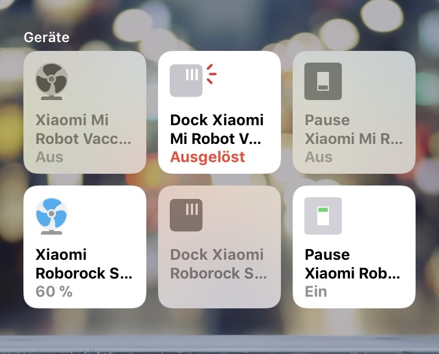
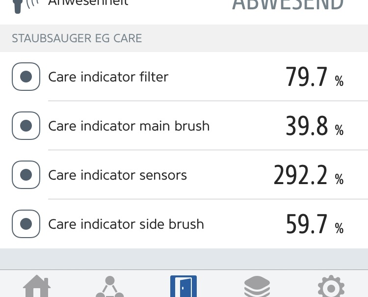

<!-- prettier-ignore -->
> [!NOTE]
> **Beta testers wanted**
>
> The maintainer no longer owns most of the supported vacuums, so changes are developed against automated tests and validated by users on beta releases.
> If you'd like to help, [sign up as a beta tester](https://github.com/homebridge-xiaomi-roborock-vacuum/homebridge-xiaomi-roborock-vacuum/issues/1232): you'll be mentioned when a beta needs a device like yours.
> See [CONTRIBUTING.md](./CONTRIBUTING.md) for other ways to help. Co-maintainers are welcome too.

[](https://github.com/homebridge/homebridge/wiki/Verified-Plugins)
[](https://github.com/homebridge-xiaomi-roborock-vacuum/homebridge-xiaomi-roborock-vacuum)
[](https://www.npmjs.com/package/homebridge-xiaomi-roborock-vacuum)
[](https://badge.fury.io/js/homebridge-xiaomi-roborock-vacuum)
[](https://david-dm.org/homebridge-xiaomi-roborock-vacuum/homebridge-xiaomi-roborock-vacuum)
[](https://codecov.io/gh/homebridge-xiaomi-roborock-vacuum/homebridge-xiaomi-roborock-vacuum)

<!-- prettier-ignore -->
> [!TIP]
> **Matter Vacuum Alternative:**
> 
> If you want to use a Matter Vacuum instead of the current HomeKit's Fan workaround, 
> take a look at [matterbridge-xiaomi-roborock](https://github.com/afharo/matterbridge-xiaomi-roborock).

# homebridge-xiaomi-roborock-vacuum

> [!IMPORTANT]  
> This plugin is only able to integrate with devices linked to the Mi Home app.
> Devices controlled via the Roborock app change their authentication and methods and are currently not supported by this plugin. Refer to [#104](https://github.com/homebridge-xiaomi-roborock-vacuum/homebridge-xiaomi-roborock-vacuum/issues/104) for more information.

## Homebridge plugin for Xiaomi / Roborock Vacuum Cleaner's

This [homebridge](https://github.com/homebridge/homebridge) plugin allows you to control the Xiaomi vacuum robots in your Apple Home App (HomeKit).

It is currently presented in the Home App in the form of a Fan because Apple doesn't officially support Vacuums in Homekit (we can't wait for this moment to arrive)! Refer to [#934](https://github.com/homebridge-xiaomi-roborock-vacuum/homebridge-xiaomi-roborock-vacuum/issues/934) to know more about that.

&nbsp;&nbsp;&nbsp;&nbsp;&nbsp;&nbsp;&nbsp;&nbsp;&nbsp;&nbsp;&nbsp;&nbsp;&nbsp;&nbsp;&nbsp;&nbsp;&nbsp;&nbsp;

For the underlying communication layer, it uses a port of the no-longer maintained library [miio](https://github.com/aholstenson/miio). You'll find the code in the directory [./miio](./miio).

## Features

- **Robot vacuum in Apple Home** (Matter, optional): the native vacuum tile, with its rooms and clean modes. Read [Robot vacuum (Matter)](#robot-vacuum-matter).
- **Fan** as On-/Off-Switch. When switching off, directly back to the charging station.
  - [Fanspeed levels](./src/models/speedmodes.ts) adjustable via 3D Touch / Force Touch.
- Battery status and condition in the device details. Low battery alert.
- Pause switch (optional).
- Room cleaning (optional): Read [Room cleaning](#room-cleaning) to understand how it works.
- Zone cleaning (optional): Read [Zone cleaning](#zone-cleaning) to understand how it works.
- Occupancy sensor (similar to motion sensor) for dock status (optional).
- Occupancy sensors for the room the robot is in, and its position in the logs (optional, Roborock, needs the Xiaomi Cloud): read [Current room](#current-room-xiaomi-cloud).
- Second Fan for water box modes (optional).
  - [Watermode levels](./src/models/watermodes.ts) only when enabled in config, and the device supports it.




## Instructions

1. Install the plugin as `root` (`sudo su -`) with `npm install -g homebridge-xiaomi-roborock-vacuum@latest --unsafe-perm`.
2. Customize you homebridge configuration `config.json`.
3. Restart homebridge, ggf. `service homebridge restart`.

- Example `config.json` with one vacuum and room cleaning:

```JSONC
{
  // Recommended: Define it as a platform.
  // Better handling of discover, and model-specific features.
  "platforms": [
    {
      "platform": "XiaomiRoborockVacuum",
      "devices": [
        {
          "name": "Xiaomi Mi Robot Vacuum 1st Generation",
          "ip": "192.168.1.150",
          "token": "abcdef1234567890abcdef1234567890",
          "serviceType": "fan",
          "pause": false,
          "dock": true,
          "waterBox": false,
          "cleanword": "cleaning",
          "rooms": [
            {
              "id": 16,
              "name": "Livingroom"
            },
            {
              "id": 17,
              "name": "Kitchen"
            }
          ],
          "zones": [
            {
              "name":"Family Room (x2)",
              "zone":[[25000,25000,32000,32000,2]]
            },
            {
              "name":"Bedroom",
              "zone":[[21000,32000,24000,37000,1]]
            },
            {
              "name":"Bedroom & Family Room",
              "zone":[ [21000,32000,24000,37000,1],  [25000,25000,32000,32000,1]]
            }
          ]
        }
      ]
    }
  ],

  // Legacy: define it as an accessory.
  // Everything is preset, and the plugin tries to connect and address the commands based on the info provided here.
  // Note: the Homebridge UI can only edit the platform format. Accessory configs keep working, but they need to be edited as JSON.
  // The plugin's settings page can move them to the platform format in one click (see "Settings page" below).
  "accessories": [
    {
      "accessory": "XiaomiRoborockVacuum",
      "name": "Xiaomi Mi Robot Vacuum 1st Generation",
      "ip": "192.168.1.150",
      "token": "abcdef1234567890abcdef1234567890",
      "serviceType": "fan",
      "pause": false,
      "dock": true,
      "waterBox": false,
      "cleanword": "cleaning",
      "rooms": [
        {
          "id": 16,
          "name": "Livingroom"
        },
        {
          "id": 17,
          "name": "Kitchen"
        }
      ],
      "zones": [
        {
          "name":"Family Room (x2)",
          "zone":[[25000,25000,32000,32000,2]]
        },
        {
          "name":"Bedroom",
          "zone":[[21000,32000,24000,37000,1]]
        },
        {
          "name":"Bedroom & Family Room",
          "zone":[ [21000,32000,24000,37000,1],  [25000,25000,32000,32000,1]]
        }
      ]
    }
  ],
}
```

- Example `config.json` with two vacuums:

```JSONC
{
  // Recommended: Define it as a platform.
  "platforms": [
    {
      "platform": "XiaomiRoborockVacuum",
      "devices": [
        {
          "name": "Xiaomi Mi Robot Vacuum 1st Generation",
          "ip": "192.168.1.150",
          "token": "abcdef1234567890abcdef1234567890",
          "pause": false,
          "dock": true,
          "waterBox": false
        },
        {
          "name": "Xiaomi Roborock S50 Vacuum 2nd Generation",
          "ip": "192.168.1.151",
          "token": "1234567890abcdef1234567890abcdef",
          "pause": false,
          "dock": true,
          "waterBox": false
        }
      ]
    },
  ],

  // Legacy: define it as an accessory.
  "accessories": [
    {
      "accessory": "XiaomiRoborockVacuum",
      "name": "Xiaomi Mi Robot Vaccum 1st Generation",
      "ip": "192.168.1.150",
      "token": "abcdef1234567890abcdef1234567890",
      "pause": false,
      "dock": true,
      "waterBox": false
    },
    {
      "accessory": "XiaomiRoborockVacuum",
      "name": "Xiaomi Roborock S50 Vaccum 2nd Generation",
      "ip": "192.168.1.151",
      "token": "1234567890abcdef1234567890abcdef",
      "pause": false,
      "dock": true,
      "waterBox": false
    }
  ],
}
```

## Optional parameters

| Name of parameter     | Default value            | Notes                                                                                                                                                                                                                                                                                                                                                                                                                                                                                                                                                                                                |
| --------------------- | ------------------------ | ---------------------------------------------------------------------------------------------------------------------------------------------------------------------------------------------------------------------------------------------------------------------------------------------------------------------------------------------------------------------------------------------------------------------------------------------------------------------------------------------------------------------------------------------------------------------------------------------------- |
| `debug`               | `false`                  | when set to true, the debug logs (including what the vacuum answers) are shown as regular logs, without enabling Homebridge's debug mode (`-D`) for every plugin. Enable it when reporting an issue                                                                                                                                                                                                                                                                                                                                                                                                  |
| `silent`              | `false`                  | when set to true, it will log only warning and error messages (hiding info and debug messages even when running homebridge -D                                                                                                                                                                                                                                                                                                                                                                                                                                                                        |
| `serviceType`         | `"fan"`                  | Defines the type of service of how the accessory is exposed. <br />When set to `"fan"` (default), ON/OFF controls and speed selection can be controlled by sliding the fan speed in the Home app. <br />When set to `"switch"`, only ON/OFF controls are allowed (no speed selection). <br />When set to `"vacuum"` (platform only), it's a Matter robot vacuum: see [Robot vacuum (Matter)](#robot-vacuum-matter).                                                                                                                                                                                  |
| `pause`               | `false`                  | when set to `true`, HomeKit shows an additional switch for "pause" - switch is on, when pause is possible                                                                                                                                                                                                                                                                                                                                                                                                                                                                                            |
| `pauseWord`           | `"pause"`                | used for naming the Pause comment                                                                                                                                                                                                                                                                                                                                                                                                                                                                                                                                                                    |
| `findMe`              | `false`                  | when set to true, HomeKit shows an additional switch for "find me" - if switched on, the vacuum will say "Hi, I am over here"                                                                                                                                                                                                                                                                                                                                                                                                                                                                        |
| `findMeWord`          | `"where are you"`        | used for autonaming the "find me" command. E.g: Hey Siri, NameOfYourVacuum where are you                                                                                                                                                                                                                                                                                                                                                                                                                                                                                                             |
| `goTo`                | `false`                  | when set to true, HomeKit shows an additional switch for "go to" - if switched on, you will be able to send your vacuum to the specified location                                                                                                                                                                                                                                                                                                                                                                                                                                                    |
| `goToWord`            | `"go to coordinates"`    | used for autonaming the "go to" command. E.g: Hey Siri, NameOfYourVacuum to to coordinates                                                                                                                                                                                                                                                                                                                                                                                                                                                                                                           |
| `goToX`               | `25500`                  | x-coordinate of the specified location                                                                                                                                                                                                                                                                                                                                                                                                                                                                                                                                                               |
| `goToY`               | `25500`                  | y-coordinate of the specified location                                                                                                                                                                                                                                                                                                                                                                                                                                                                                                                                                               |
| `goToSpots`           | `[]`                     | Array of `{ "name", "x", "y" }`: a "go to …" switch per spot. On sends the robot there, off sends it back to the dock. The [settings page](#settings-page-tokens-room-names-spots-and-zones-from-the-map) picks them on the map                                                                                                                                                                                                                                                                                                                                                                      |
| `goToSpotWord`        | `"go to"`                | the first word(s) of the spots' switches, in your language. E.g: "go to Kitchen door"                                                                                                                                                                                                                                                                                                                                                                                                                                                                                                                |
| `goToDock`            | `false`                  | when set to true, HomeKit shows an additional switch that sends the robot back to the dock. It is on while the robot is on its way (turning it off stops the robot)                                                                                                                                                                                                                                                                                                                                                                                                                                  |
| `goToDockWord`        | `"go to dock"`           | used for naming the "go to dock" switch. E.g: Hey Siri, turn on NameOfYourVacuum go to dock                                                                                                                                                                                                                                                                                                                                                                                                                                                                                                          |
| `dock`                | `false`                  | when set to true, HomeKit shows an occupancy sensor, if robot is in the charging dock                                                                                                                                                                                                                                                                                                                                                                                                                                                                                                                |
| `roomSensors`         | `false`                  | when set to true, HomeKit shows an occupancy sensor per room, detected while the robot is in it. Roborock only, needs the platform's `cloud` option: see [Current room](#current-room-xiaomi-cloud)                                                                                                                                                                                                                                                                                                                                                                                                  |
| `waterBox`            | `false` (platform: auto) | when set to true, HomeKit shows an additional slider to control the amount of water released by the robot. When registered as a platform, it's enabled automatically on the models that support it unless set explicitly.                                                                                                                                                                                                                                                                                                                                                                            |
| `dustBin`             | `false`                  | when set to true, HomeKit shows a lock that is _secured_ whenever the robot throws the dust-bin full error. Currently in a beta state.                                                                                                                                                                                                                                                                                                                                                                                                                                                               |
| `dustCollection`      | `false`                  | when set to true, HomeKit shows an additional switch to control the dust collection with the auto-empty dock (only selected models like S7+ or S7 with additional dock). Currently in a beta state                                                                                                                                                                                                                                                                                                                                                                                                   |
| `mopWash`             | `false`                  | when set to true, HomeKit shows a button to wash the mop in the dock (only docks with mop washing, like the S7 MaxV Ultra or S8 Pro Ultra)                                                                                                                                                                                                                                                                                                                                                                                                                                                           |
| `mopDrying`           | `false`                  | when set to true, HomeKit shows a switch to dry the mop in the dock (only docks with a mop dryer, like the S8 Pro Ultra). It is on while the mop is drying                                                                                                                                                                                                                                                                                                                                                                                                                                           |
| `waterTankEmpty`      | `false`                  | when set to true, HomeKit shows an occupancy sensor that detects when the clean water tank is empty. Only for models that report it (usually the ones with a self-refilling dock)                                                                                                                                                                                                                                                                                                                                                                                                                    |
| `disableCareServices` | `false`                  | when set to true, HomeKit doesn't shows additional Care Services                                                                                                                                                                                                                                                                                                                                                                                                                                                                                                                                     |
| `cleanword`           | `"cleaning"`             | used for autonaming the Roomselectors                                                                                                                                                                                                                                                                                                                                                                                                                                                                                                                                                                |
| `rooms`               | `[]`                     | Array of ID / Name for a single Room. If set you have another switch for cleaning only this room. Add `"repeats": [2, 3]` to a room to also get switches that clean it 2 or 3 times ("Kitchen 2x"): the robot takes one count per run, so the highest of the selected switches wins. The [settings page](#settings-page-tokens-room-names-spots-and-zones-from-the-map) sets them from the map                                                                                                                                                                                                       |
| `zones`               | `[]`                     | Array of name / zone coordinates for a single zone group. A zone group may contain multiple zone squares, each with its own value for number of cleanings. Coordinates are laid out as bottom-left-x, bottom-left-y, top-right-x, top-right-y, number-of-cleanings. A separate tile in Home will be created for each zone group. Figuring out coordinates will take some trial and error. Each zone should be surrounded by brackets: [], with the entire value also surrounded by brackets The [settings page](#settings-page-tokens-room-names-spots-and-zones-from-the-map) draws them on the map |
| `autoroom`            | `false`                  | set to `true` to generate rooms from robot (only S6) or set to array of room name strings (see semi automatic below)                                                                                                                                                                                                                                                                                                                                                                                                                                                                                 |
| `roomTimeout`         | `0`                      | when set to anything above `0` - will initiate room cleaning for multiple rooms automatically after the given time in seconds                                                                                                                                                                                                                                                                                                                                                                                                                                                                        |

## Robot vacuum (Matter)

Apple Home only shows its native robot vacuum tile for Matter devices (iOS 18.4 or later). With `"serviceType": "vacuum"`, this plugin
exposes the vacuum through Homebridge's Matter support (Homebridge v2) instead of a fan or a switch:

- Start, stop and go to the dock, pause and resume.
- The rooms: pick the ones to clean in the Home app. They're read from the robot (as with `"autoroom": true`), or from `rooms`/`autoroom` when
  configured. With the [Xiaomi Cloud](#current-room-xiaomi-cloud), the Home app shows the room the robot is in.
- The clean modes: one per fan speed, mop-only modes (on the models with a "Mop" fan speed), and vacuum & mop presets (Automatic, Deep
  clean, Quiet) on the models with a water box.
- The battery, the dock states (charging, emptying the dust bin, washing the mop…) and the errors (e.g. "brush jammed").

It replaces the HomeKit switches and sensors for all of that: `pause`, `findMe`, `goToDock`, `dock`, `waterBox`, `roomSensors` and the room
switches aren't shown. The ones Matter doesn't cover still are, when enabled, in a separate HomeKit accessory: `zones`, `goTo`, `goToSpots`,
`dustBin`, `dustCollection`, `mopWash`, `mopDrying`, `waterTankEmpty` and the care sensors (`disableCareServices` hides them).

### How can I set it up

1. Use the platform (the `platforms` section, as the settings page does).
2. Enable Matter in the bridge that runs this plugin: a `matter` block in its `_bridge` (a child bridge, recommended), or in `bridge` (the main
   bridge). In the Homebridge UI, it's in the bridge settings.

   ```json
   {
     "platform": "XiaomiRoborockVacuum",
     "devices": [
       {
         "name": "Vacuum",
         "ip": "192.168.1.10",
         "token": "…",
         "serviceType": "vacuum"
       }
     ],
     "_bridge": { "username": "0E:12:34:56:78:9A", "port": 51830, "matter": {} }
   }
   ```

3. Restart Homebridge, and add the vacuum in the Home app with its own pairing code: it's shown in the Homebridge UI and in the logs
   (`Commissioning codes for …`). The vacuum is paired separately from the bridge, as Apple Home requires for robot vacuums.

Without Matter, the plugin logs a warning and shows the vacuum as a fan. Switching back to `"fan"` or `"switch"` removes the Matter vacuum (remove
it from the Home app too).

## Room cleaning

This plugin supports Room cleaning (only models that support room cleaning via the Xiaomi Mi Home app). Keep reading to understand how it works and how to set it up.

### How it works

To start the Room Clean Mode, you can enable/disable the room switches in the
order that they need to be cleaned. Then turn on the main Fan switch to start
the actual cleaning.

If you want your robot to start cleaning after you enable/disable the room switches, use the config parameter `roomTimeout` to set the number of seconds the robot should wait before starting (this is to allow you to find the other rooms you want to set ON/OFF).

### How can I set it up

#### Semi automatic

This feature seems to work with all models which offer room cleaning, but may not work on newer firmware versions (3.5.8_0358 or newer). To use it:

1. Set the `autoroom` property in the config to an array of room names (`["my room 1", "my room 2", "my room 3"]`.
2. In the Xiaomi Mi app, setup a timer at midnight (00:00 or 12:00am).
3. Enable `Select a room to divide`.
4. On the map select the rooms in the order as they appear in the config set in step 1. The order is important as this is how the plugin maps the room names to IDs.
5. Submit the timer and make sure it's deactivated.
6. Restart `homebridge`.

When registered as a **platform**, the room IDs are resolved on every start and saved automatically: there's no need to copy them into `rooms`, and the switches keep working even if the timer is deleted later. In the legacy **accessory** mode, the logs show the resolved `rooms` config, which you can copy to your config to stop depending on the timer.

#### Fully automatic

This feature seems to be working on models that support naming the rooms in the Xiaomi / Roborock App. This is known to include the Roborock S6 as well as the S4 with firmware version 3.5.8_0358 or newer.

Even if you have one of these models but you haven't named the Rooms in your App yet, this function will not work! Thanks @domeOo

This mode requires registering the plugin as a **platform**: the rooms are only known after connecting to the robot, and accessories can't add switches after Homebridge starts. The rooms are saved automatically, so they are still available if the robot can't be reached on the next start.

## Zone cleaning

This plugin supports Zone cleaning (only models that support zone cleaning via the Xiaomi Mi Home app). Keep reading to understand how it works and how to set it up.

### How it works

To start the Zone Clean Mode, you can enable the zone switch for the zone to be cleaned.

#### Fan speed and water level per zone

Each zone can set the fan speed (`speed`) and the water level (`waterSpeed`) before starting, e.g. to vacuum a zone
first and mop it afterwards with a second switch:

```json
"zones": [
  { "name": "Kitchen", "zone": [[24500, 27000, 28000, 30000, 1]], "speed": "Max", "waterSpeed": "Off" },
  { "name": "Kitchen mop", "zone": [[24500, 27000, 28000, 30000, 1]], "speed": "Mop", "waterSpeed": "High" }
]
```

- The names are the ones of your model's [fan speeds](./src/models/speedmodes.ts) and [water levels](./src/models/watermodes.ts)
  (the same steps as the sliders in HomeKit). The robot keeps them after the cleaning, as when you change them from HomeKit.
- `"Mop"` turns the suction off (mop only): S7 and newer (S7, S7 MaxV, S8, S7 Max Ultra, Q8 Max, Q Revo), with the mop
  attached. On the older models, the lowest speed is `"Soft"`, which still vacuums.
- `waterSpeed` needs the water box (`waterBox`, enabled automatically in platform mode on the models that support it).
- Leave them out to keep the current speed and water level.

### How can I set it up

Open terminal and run:
`pip install python-miio`
After proper installation run:
`mirobo --ip 192.168.1.XX --token xxxxxxxxxxxxxxxxxxxxxxxxxxxxxxxx goto X_COORD Y_COORD`
repeat the goto command until you figure out the bottom-left and top-right position of the zone.

when you have your zone. Go back to the JSON configuration in homberidge and add this lines.</br>
zone: [[bottom-left X, bottom-left Y, top-right X, top-right Y, # of cleanings]]

```
"zones": [
  {
    "name": "Bed room",
    "zone": [
      [
        24500,
        27000,
        28000,
        30000,
        1
      ]
    ]
  }
]
```


Additional hint:

- The position near the docking station is 25500 25500 (X/Y)
- Driving downwards the map is possible by decreasing Y (i.e. 25000)
- Driving upwards the map is possible by increasing Y (i.e. 26000)
- Driving left of the map is possible by decreasing X (i.e. 25000)
- Driving right the map is possible by increasing X (i.e. 26000)
- If you prefer not to install python-miio or encounter issues during installation, you can configure your vacuum directly in Homebridge. Go to the JSON Config section, find your vacuum settings, and add or modify goToX and goToY with different values. Then, toggle the switch in your Home app. Repeat this until you determine the correct values for your zone.

  `"goToX": 24500, "goToY": 29000`

  

## Go to Location

This plugin allows you to send your vacuum to a specific point on the map. As there is no easy way of figuring out the coordinates of your desired location, here are some steps to help you find the right spot.

1. The base location (typically the position of the dock when the map was created) is at `[25500,25500]` where these values are in the format `[x-axis/horizontal, y-axis/vertical]`.
2. Increasing the first value results in going to the top of the map, increasing the second value results in going to the right of the map (as displayed inside the app). The value seems to be in Millimeters.
3. Knowing this you can approximate the desired location and change it as follows. In our example we want to go one meter up and three meters to the right: `[25500,25500]` --> `[26500,28500]`.
4. While testing this location you can review the position in your app under `Go To` to fine tune it.

With the [Xiaomi Cloud](#current-room-xiaomi-cloud) enabled, the plugin tells you the coordinates: drive the robot to the spot (e.g. with the remote control in the app), then turn on the "find me" switch (`findMe`). The robot says hello, and the logs show `The robot is at x=…, y=…`. The logs also show where the robot stops after each cleaning.

## Current room (Xiaomi Cloud)

The robot doesn't tell which room it's in over the local network: only its map knows, and the map is in the Xiaomi
Cloud. With the platform's `cloud` option, the plugin downloads the map while the robot cleans (every 10 seconds) to
know the room it's in and its position. Only Roborock vacuums, and only when the plugin is registered as a platform.

1. Log in to your Xiaomi account once: in the plugin's settings in the Homebridge UI, click "Log in with a QR code" and
   scan it with the Mi Home app. Without the Homebridge UI, run this **as the same user that runs Homebridge**:

   ```sh
   npx node-miio cloud login --qr   # scan the QR code with the Mi Home app
   ```

   The session is saved in [node-miio's config directory](https://github.com/afharo/node-miio/blob/main/docs/cloud.md)
   (your password is never stored). If Homebridge runs as another user, copy that file where Homebridge can read it,
   and set its path in `cloud.sessionFile`.

2. Enable it in the platform's config (in the UI: "Xiaomi Cloud (optional)"), and `roomSensors` in the vacuum's:

   ```json
   {
     "platform": "XiaomiRoborockVacuum",
     "cloud": { "enabled": true },
     "devices": [
       {
         "name": "Robot",
         "ip": "…",
         "token": "…",
         "autoroom": true,
         "roomSensors": true
       }
     ]
   }
   ```

   Optionally, set `cloud.server` (`de`, `us`, `cn`…) to skip looking for the robot in every server.

With the `cloud` option, the robots' `token` is optional too: a robot configured with only its `ip` gets its token from
your Xiaomi account when Homebridge starts. The IP must be the one the Mi Home app shows. This works for every model,
not only Roborock.

Even simpler, configure the robot with its device ID (`did`) instead of its IP and token:

```json
{ "name": "Robot", "did": "123456789" }
```

The plugin reads the IP and token from your Xiaomi account, and **finds the robot again if they change**: when the
robot stops answering (a new IP from the router, or a new token after resetting its Wi-Fi), the plugin asks the Xiaomi
account where it is now, and reconnects. The `did` is in the logs (`Xiaomi Cloud: found "Robot" (did 123456789) at …`)
and in `npx node-miio cloud devices`. A fixed IP for the robot in your router is still the most reliable setup: the
Xiaomi account only knows the new IP once the robot reports it.

You get an occupancy sensor per room ("Robot in Kitchen"), detected while the robot is in it: use them in automations.
The rooms are the ones of the room cleaning switches (`rooms` or `autoroom`). If the session expires, the plugin logs a
warning: log in again and restart Homebridge.

## Settings page: tokens, room names, spots and zones from the map

The plugin's settings in the Homebridge UI show, above the usual form:

- **Vacuums in the old format** (`accessories`, before 1.0), if any: the UI can't show or change them, and this
  page moves them to the platform format in one click, with all their options and their child bridge. A backup of the
  config is saved first. The Home app sees them as new accessories: put them back in their rooms, and update your
  scenes and automations.
- **Xiaomi Cloud login** with a QR code (scan it with the Mi Home app: no password needed).
- **Your vacuums** in the Xiaomi account: add them, with their device ID (`did`), IP and token, in one click (or update
  their token). With the `did`, the plugin finds them again if their IP or token change.
- **The map** of a Roborock vacuum, with three tools:
  - **Rooms:** click a room to name it. The names are saved as the vacuum's `rooms` (the room cleaning switches),
    replacing `autoroom`. It's handy when the app doesn't let you name the rooms, or the robot doesn't report their
    names. Tick **2x** / **3x** to also get switches that clean the room 2 or 3 times (`repeats`).
  - **"Go to" spots:** click on the map to add a spot (`goToSpots`): a switch that sends the robot there.
  - **Zones:** drag on the map to draw a zone (`zones`), cleaned 1 to 3 times.

  The page explains the limits of each tool: the robot takes one repeat count per run (the highest wins), it cleans a
  room at most 3 times, and spots and zones belong to the current map (pick them again if the map is reset).

Click "Save" afterwards to apply the changes. The usual settings form is still there, below these tools: they only
fill it in.


## Xiaomi Token

To use this plugin, you need the "token" of the Xiaomi vacuum robots. The easiest way is to let the plugin read it from
your Xiaomi account: enable the [Xiaomi Cloud](#current-room-xiaomi-cloud), and configure only the robot's `ip`, or its
`did`. The [settings page](#settings-page-tokens-room-names-spots-and-zones-from-the-map) in the Homebridge UI also
adds your vacuums in one click. Or print the tokens of all your devices with node-miio:

```sh
npx node-miio cloud login --qr   # scan the QR code with the Mi Home app
npx node-miio cloud devices      # name, model, IP and token of each device
```

Other ways to get it:

- :us::gb: - [Xiaomi cloud tokens extractor](https://github.com/PiotrMachowski/Xiaomi-cloud-tokens-extractor)
- :us::gb: - [python-miio - Getting started](https://python-miio.readthedocs.io/en/latest/discovery.html)
- :de: - [Apple HomeKit Forum - HomeKit.Community](https://forum.smartapfel.de/forum/thread/370-xiaomi-token-auslesen/)
- :de: - [Homematic-Guru.de](https://homematic-guru.de/xiaomi-vacuum-staubsauger-roboter-mit-homematic-steuern)
- :de: - [Tutorial with token extractor - simon42.com](https://www.simon42.com/roborock-homekit-token-einfach/)

NOTE: We are not currently aware of how to retrieve the token from the Roborock App. Please, share any findings in the issue [#104](https://github.com/homebridge-xiaomi-roborock-vacuum/homebridge-xiaomi-roborock-vacuum/issues/104).

## Is my model supported?

As new users join our community, and use this plugin, we try to learn from their device, and keep up with the new devices Xiaomi releases. However, the maintainer can't test the features on most models, so we rely on users like you: see [CONTRIBUTING.md](./CONTRIBUTING.md) for what to share when requesting a model or a feature, and how to become a beta tester. If you wonder whether your device is supported, please:

1. Check the [models.ts](./src/models/models.ts) file to see if your device is already in the explicit list.
2. If not, maybe it matches the _default_ behaviour (just try running the plugin and see if it works).
   1. Newer (MIoT) models are driven by their spec from [miot-spec.org](https://home.miot-spec.com) via [node-miio](https://github.com/afharo/node-miio), including their fan speeds and water levels. Run `npx node-miio spec your.model.id` to see what it resolves for your model, and attach the output to your bug report.
   2. If it works, but the vacuum modes (aka speeds) are wrong: please, open an issue (or a PR in [node-miio](https://github.com/afharo/node-miio)) with the right mapping.
   3. If it doesn't work, please, try making sure the IP and token are correct, by running the command `miio-vacuum inspect id-or-address --token tokenAsHex`.  
      HINT: Try a couple of times, just in case there's a network glitch.
   4. If you can connect and see the details of your robot, try running the manual commands like explained in [here](https://github.com/afharo/node-miio/blob/main/docs/protocol.md#testing-commands).

## My model is, allegedly, supported, but it fails to connect

Run the command `miio-vacuum inspect id-or-address --token tokenAsHex`, replacing `id-or-address` with your vacuum's IP address and the `tokenAsHex` with a HEX representation of the token obtained [earlier](#xiaomi-token).
