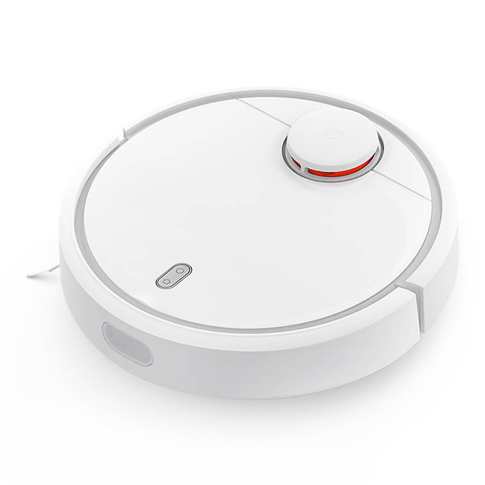
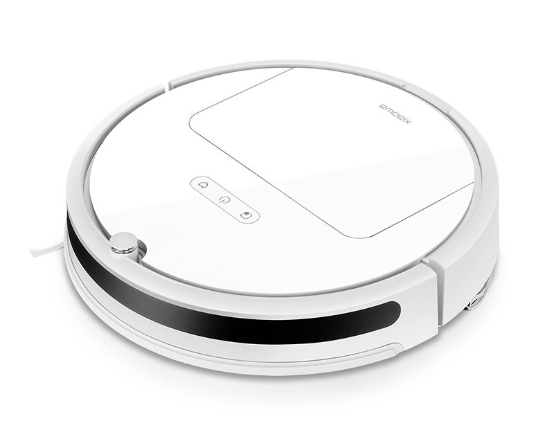
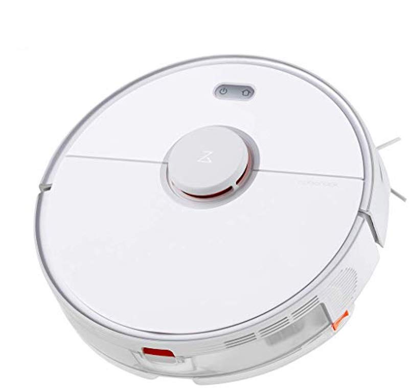
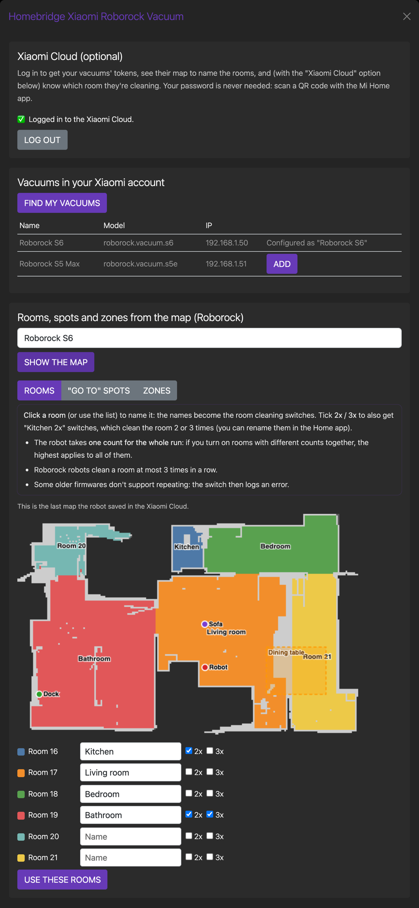

<!-- prettier-ignore -->
> [!NOTE]
> **Beta testers wanted**
>
> The maintainer no longer owns most of the supported vacuums, so changes are developed against automated tests and validated by users.
> If you'd like to help, [sign up as a beta tester](https://github.com/homebridge-xiaomi-roborock-vacuum/homebridge-xiaomi-roborock-vacuum/issues/1232): you'll be mentioned when a beta needs a device like yours.
> See [CONTRIBUTING.md](./CONTRIBUTING.md) for other ways to help. Co-maintainers are welcome too.

<p align="center">
  
  
  
</p>

<h1 align="center">homebridge-xiaomi-roborock-vacuum</h1>

<p align="center">
  <a href="https://github.com/homebridge/homebridge/wiki/Verified-Plugins"></a>
  <a href="https://www.npmjs.com/package/homebridge-xiaomi-roborock-vacuum"></a>
  <a href="https://www.npmjs.com/package/homebridge-xiaomi-roborock-vacuum"></a>
  <a href="https://github.com/homebridge-xiaomi-roborock-vacuum/homebridge-xiaomi-roborock-vacuum"></a>
  <a href="https://codecov.io/gh/homebridge-xiaomi-roborock-vacuum/homebridge-xiaomi-roborock-vacuum"></a>
</p>

A [Homebridge](https://homebridge.io) plugin to control the Xiaomi / Roborock robot vacuums in the Apple Home app:
as Apple Home's **native robot vacuum** (through Homebridge's Matter support), or as a fan with extra switches and
sensors. It talks to the robot in your local network, with [node-miio](https://github.com/afharo/node-miio).

> [!NOTE]
> Made for the vacuums paired with the  **Mi Home** app. The ones paired with the  **Roborock app** are
> supported too, experimentally: see [Roborock app](#roborock-app-experimental).

<p>






</p>

## Contents

- [Features](#features)
- [Installation](#installation)
- [How the vacuum shows up](#how-the-vacuum-shows-up): [robot vacuum (Matter)](#robot-vacuum-matter), or fan / switch
- [Options](#options)
- [Rooms](#rooms) · [Zones](#zones) · [Go to a spot](#go-to-a-spot)
- [Xiaomi Cloud](#xiaomi-cloud): tokens, device ID, current room
- [Roborock app](#roborock-app-experimental): robots paired with the Roborock app
- [Settings page](#settings-page)
- [Troubleshooting](#troubleshooting)

## Features

- **Apple Home's robot vacuum** (iOS 18.4+): rooms, clean modes, battery, dock states and errors.
- Or a **fan** (on/off and the [fan speed](./src/models/speedmodes.ts)) or a **switch**, with a second fan for the
  [water level](./src/models/watermodes.ts).
- **Room and zone cleaning**, with the rooms read from the robot, or named and drawn on its map in the
  [settings page](#settings-page).
- **Switches**: pause, find me, go to the dock, go to a spot, dust collection, wash and dry the mop, Do Not Disturb.
- **Sensors**: in the dock, room the robot is in, water tank empty, error, needs maintenance, and the remaining
  life of the brushes, filter and sensors (with a reset after replacing them).
- **No token hunting**: log in to your Xiaomi account with a QR code, and the plugin reads the tokens (and finds the
  robot again if its IP changes).

Most of them are optional: see [Options](#options). Some depend on the model (e.g. only the Roborock vacuums report
the room they're in).

## Installation

1. Install the plugin from the Homebridge UI (search for "Xiaomi Roborock Vacuum"), or with
   `npm install -g homebridge-xiaomi-roborock-vacuum`. It needs Homebridge 2.3 or later.
2. Open the plugin's settings in the Homebridge UI. The [settings page](#settings-page) logs in to your Xiaomi account
   with a QR code and adds your vacuums, with their tokens, in one click.
3. Pick [how the vacuum shows up](#how-the-vacuum-shows-up), enable the [options](#options) you want, save, and
   restart Homebridge.

Without the Homebridge UI, add the platform to `config.json` yourself (see [Xiaomi Cloud](#xiaomi-cloud) to get the
token):

```json
{
  "platforms": [
    {
      "platform": "XiaomiRoborockVacuum",
      "devices": [
        {
          "name": "Vacuum",
          "ip": "192.168.1.150",
          "token": "abcdef1234567890abcdef1234567890",
          "rooms": [
            { "id": 16, "name": "Living room" },
            { "id": 17, "name": "Kitchen" }
          ]
        }
      ]
    }
  ]
}
```

Add one entry to `devices` per vacuum.

> [!NOTE]
> Vacuums configured in the old format (`"accessories": [{ "accessory": "XiaomiRoborockVacuum", … }]`, before 1.0)
> still work, but the Homebridge UI can't edit them, and some features need the platform (`rooms` read from the robot,
> the Matter vacuum, the Xiaomi Cloud). The settings page moves them to the platform in one click.

## How the vacuum shows up

`serviceType` picks it:

- `"vacuum"`: Apple Home's native [robot vacuum (Matter)](#robot-vacuum-matter). Recommended with iOS 18.4 or later.
- `"fan"` (default): a fan. On starts the cleaning, off sends the robot to the dock, and the speed is the fan speed.
- `"switch"`: a switch, on/off only.


### Robot vacuum (Matter)

Apple Home only shows its robot vacuum tile for Matter devices. With `"serviceType": "vacuum"`, the plugin exposes the
vacuum through Homebridge's Matter support:

- Start, stop, pause, resume and go to the dock.
- The rooms: pick the ones to clean in the Home app. They're read from the robot, or taken from `rooms` / `autoroom`
  when set. With the [Xiaomi Cloud](#xiaomi-cloud) or the [Roborock app](#roborock-app-experimental), the Home app shows
  the room the robot is in.
- The clean modes: one per fan speed, mop-only (on the models with a "Mop" fan speed), and vacuum & mop presets
  (Automatic, Deep clean, Quiet) on the models with a water box.
- The battery, the dock states (charging, emptying the dust bin, washing the mop…) and the errors.

To set it up:

1. Enable Matter in the bridge that runs the plugin: a `matter` block in its `_bridge` (a child bridge, recommended)
   or in `bridge`. In the Homebridge UI, it's in the bridge settings.

   ```json
   {
     "platform": "XiaomiRoborockVacuum",
     "devices": [
       {
         "name": "Vacuum",
         "ip": "192.168.1.150",
         "token": "…",
         "serviceType": "vacuum"
       }
     ],
     "_bridge": { "username": "0E:12:34:56:78:9A", "port": 51830, "matter": {} }
   }
   ```

2. Restart Homebridge, and add the vacuum in the Home app with **its own pairing code**, shown in the Homebridge UI and
   in the logs (`Commissioning codes for …`). Apple Home pairs robot vacuums separately from the bridge.
   It gets the vacuum's `name`. Vacuums paired before 1.5.0 were named after their model (e.g. `roborock.vacuum.a15`):
   rename them in the Home app.

The Matter vacuum replaces the fan and these options: `pause`, `findMe`, `goToDock`, `dock`, `waterBox`,
`roomSensors` and the room switches. The options Matter doesn't cover stay in HomeKit, as a separate accessory, when
enabled: zones, go to, spots, dust bin and collection, mop wash and drying, water tank, Do Not Disturb, the error and
maintenance sensors, and the care services (only with `"disableCareServices": false`).

Without Matter, the plugin logs a warning and shows a fan. Switching back to `"fan"` or `"switch"` removes the Matter
vacuum: remove it from the Home app too.

## Options

Each vacuum in `devices` takes these options. They're all in the Homebridge UI's form.

**Connection**

| Option   | Default | Description                                                                                                    |
| -------- | ------- | -------------------------------------------------------------------------------------------------------------- |
| `name`   |         | The name in the Home app. The switches and sensors are named after it                                          |
| `ip`     |         | The robot's IP address (give it a fixed one in your router)                                                    |
| `token`  |         | The robot's token. Optional with the [Xiaomi Cloud](#xiaomi-cloud)                                             |
| `did`    |         | Instead of `ip` and `token`, with the [Xiaomi Cloud](#xiaomi-cloud): the device ID, found again if they change |
| `debug`  | `false` | Show the debug logs (including what the robot answers) of this plugin only. Enable it when reporting an issue  |
| `silent` | `false` | Only log warnings and errors                                                                                   |

**How it shows up**

| Option        | Default                  | Description                                                                                |
| ------------- | ------------------------ | ------------------------------------------------------------------------------------------ |
| `serviceType` | `"fan"`                  | `"vacuum"`, `"fan"` or `"switch"`: see [How the vacuum shows up](#how-the-vacuum-shows-up) |
| `waterBox`    | `false` (platform: auto) | A second fan for the water level. Enabled automatically on the models with a water box     |

**Switches**

| Option                                 | Default                        | Description                                                                                                                         |
| -------------------------------------- | ------------------------------ | ----------------------------------------------------------------------------------------------------------------------------------- |
| `pause`, `pauseWord`                   | `false`, `"Pause"`             | A pause switch: on while the robot cleans. Turning it off pauses it, and on resumes it                                              |
| `findMe`, `findMeWord`                 | `false`, `"where are you"`     | A "find me" switch: the robot says "I'm here"                                                                                       |
| `goToDock`, `goToDockWord`             | `false`, `"go to dock"`        | Sends the robot to the dock. It's on while the robot is on its way, and turning it off stops it                                     |
| `goTo`, `goToWord`, `goToX`, `goToY`   | `false`, `"go to coordinates"` | Sends the robot to a spot (`goToX`, `goToY`, `25500` by default): see [Go to a spot](#go-to-a-spot)                                 |
| `goToSpots`, `goToSpotWord`            | `[]`, `"go to"`                | A switch per spot, `[{ "name", "x", "y" }]`: on sends the robot there, off sends it to the dock                                     |
| `dustCollection`                       | `false`                        | Empty the dust bin in the auto-empty dock (e.g. S7+)                                                                                |
| `mopWash`                              | `false`                        | A button to wash the mop in the dock (e.g. S7 MaxV Ultra, S8 Pro Ultra)                                                             |
| `mopDrying`                            | `false`                        | Dry the mop in the dock (e.g. S8 Pro Ultra). It's on while the mop dries                                                            |
| `doNotDisturb`, `doNotDisturbWord`     | `false`, `"Do Not Disturb"`    | The robot's Do Not Disturb schedule (Roborock): no voice, dimmed lights, and the dock doesn't empty the dust bin                    |
| `doNotDisturbStart`, `doNotDisturbEnd` |                                | The schedule (`"HH:mm"`) set when the Do Not Disturb switch turns on, e.g. `"00:00"` to `"23:59"`. Without them, the app's schedule |

**Sensors**

| Option                | Default | Description                                                                                                                                                        |
| --------------------- | ------- | ------------------------------------------------------------------------------------------------------------------------------------------------------------------ |
| `dock`                | `false` | Detected while the robot is in the dock                                                                                                                            |
| `roomSensors`         | `false` | One per room, detected while the robot is in it (Roborock, needs the [Xiaomi Cloud](#xiaomi-cloud) or the [Roborock app](#roborock-app-experimental))              |
| `waterTankEmpty`      | `false` | Detected when the clean water tank is empty (the models that report it, usually with a self-refilling dock)                                                        |
| `errorSensor`         | `false` | Detected while the robot reports an error (e.g. stuck): for notifications and automations. The error is in the logs                                                |
| `maintenanceSensor`   | `false` | Detected when the brushes, the filter or the sensors need maintenance: for notifications and automations                                                           |
| `dustBin`             | `false` | A lock, secured when the robot reports that the dust bin is full                                                                                                   |
| `disableCareServices` | `false` | Hide the remaining life of the brushes, filter and sensors (they can be reset after replacing them, on Roborock). Hidden by default with `"serviceType": "vacuum"` |

**Rooms and zones**

| Option        | Default      | Description                                                                                                        |
| ------------- | ------------ | ------------------------------------------------------------------------------------------------------------------ |
| `rooms`       | `[]`         | A switch per room, `[{ "id", "name" }]`, plus `"repeats": [2, 3]` for "clean it 2 or 3 times": see [Rooms](#rooms) |
| `autoroom`    | `false`      | Read the rooms from the robot: `true`, or the room names in the order of a timer: see [Rooms](#rooms)              |
| `roomTimeout` | `0`          | Above `0`: start cleaning the selected rooms this many seconds after the last switch change                        |
| `zones`       | `[]`         | A switch per zone: see [Zones](#zones)                                                                             |
| `zoneTimeout` | `0`          | Above `0`: the zone switches select the zones, cleaned together this many seconds after the last change            |
| `cleanword`   | `"cleaning"` | The first word of the room and zone switches, e.g. "cleaning Kitchen"                                              |

The platform also takes `cloud`: see [Xiaomi Cloud](#xiaomi-cloud).

## Rooms

Turn on the room switches in the order they should be cleaned, then start the cleaning (the fan, or the Home app's
vacuum). With `roomTimeout`, the cleaning starts on its own after the last change. With the Matter vacuum, pick the
rooms in the Home app instead.

There are three ways to get the room IDs:

- **From the map**, in the [settings page](#settings-page): click each room to name it. It's saved as `rooms`.
- **Read from the robot** (`"autoroom": true`, platform only): the models that name their rooms in the app, like the
  S6, or the S4 with firmware 3.5.8_0358 or later. The rooms must be named in the app.
  With the [Roborock app](#roborock-app-experimental), the rooms get the names given in the app.
- **From a timer** (`"autoroom": ["Room 1", "Room 2", …]`), for the other models with room cleaning (it may not work
  with firmware 3.5.8_0358 or later):
  1. In the Mi Home app, set up a timer at midnight (00:00), and enable "Select a room to divide".
  2. Select the rooms on the map, in the same order as the names in `autoroom`.
  3. Save the timer, turn it off, and restart Homebridge.

  With the platform, the room IDs are saved automatically. In the old `accessories` format, the logs show the `rooms`
  to copy to the config instead.

## Zones

Each zone is a switch that cleans one or more rectangles of the map:

```json
"zones": [
  { "name": "Bedroom", "zone": [[24500, 27000, 28000, 30000, 1]] },
  { "name": "Bedroom & hall", "zone": [[24500, 27000, 28000, 30000, 1], [21000, 32000, 24000, 37000, 2]] },
  { "name": "Kitchen mop", "zone": [[25000, 25000, 27000, 28000, 1]], "speed": "Mop", "waterSpeed": "High" }
]
```

- Each rectangle is `[bottom-left x, bottom-left y, top-right x, top-right y, times to clean it]`, in millimetres.
  The easiest way to get them is to draw them on the map in the [settings page](#settings-page).
- `speed` and `waterSpeed` (optional) set the fan speed and the water level before cleaning the zone: the names of
  your model's [fan speeds](./src/models/speedmodes.ts) and [water levels](./src/models/watermodes.ts). `"Mop"` turns
  the suction off on the S7 and newer (with the mop attached). `waterSpeed` needs `waterBox`.
- Only the switches of the zones being cleaned are on. To clean several zones in one run, set `zoneTimeout`: turning
  a zone on selects it, and the selected zones are cleaned together after that many seconds. The robot takes one fan
  speed per run: the first zone's.

## Go to a spot

`goTo` sends the robot to `goToX`, `goToY`, and `goToSpots` adds a switch per spot. The coordinates are in
millimetres, and the dock is usually near `25500, 25500` (where the robot was when it created the map).

To find a spot's coordinates:

- Click on the map in the [settings page](#settings-page).
- Or, with the [Xiaomi Cloud](#xiaomi-cloud): drive the robot there (e.g. with the remote control in the app), and
  turn on the "find me" switch. The logs show `The robot is at x=…, y=…`. They also show where the robot stops after
  each cleaning.

## Xiaomi Cloud

 The robot works in your local network, but the Xiaomi account knows its token, and its map (Roborock). With the
platform's `cloud` option, the plugin can:

- **Read the tokens**: configure a robot with only its `ip`, or with its device ID (`did`) instead of the IP and token.
  With the `did`, the plugin also **finds the robot again** when its IP or token change (a new IP from the router, or
  a reset Wi-Fi). A fixed IP in your router is still the most reliable.
- **Know the room the robot is in** (Roborock): the plugin downloads the map while it cleans (every 10 seconds), for
  `roomSensors` and the Matter vacuum's current room. Its position also goes to the logs.

To set it up:

1. Log in once: in the [settings page](#settings-page), click "Log in with a QR code" and scan it with the Mi Home app.
   Without the Homebridge UI, run this as the same user that runs Homebridge:

   ```sh
   npx node-miio cloud login --qr   # scan the QR code with the Mi Home app
   ```

   The session is saved in [node-miio's config directory](https://github.com/afharo/node-miio/blob/main/docs/cloud.md)
   (your password is never stored). If Homebridge runs as another user, copy that file where Homebridge can read it,
   and set its path in `cloud.sessionFile`.

2. Enable it in the platform (in the Homebridge UI: "Xiaomi Cloud (optional)"):

   ```json
   {
     "platform": "XiaomiRoborockVacuum",
     "cloud": { "enabled": true },
     "devices": [{ "name": "Vacuum", "did": "123456789", "roomSensors": true }]
   }
   ```

   Optionally, set `cloud.server` (`de`, `us`, `cn`…) to skip looking for the robot in every server.

The `did` is in the logs (`Xiaomi Cloud: found "Vacuum" (did 123456789) at …`) and in `npx node-miio cloud devices`,
which also prints the IP and token of every device. If the session expires, the plugin logs a warning: log in again,
and restart Homebridge.

Other ways to get a token: the [Xiaomi cloud tokens extractor](https://github.com/PiotrMachowski/Xiaomi-cloud-tokens-extractor),
or the guides in German on [smartapfel.de](https://forum.smartapfel.de/forum/thread/370-xiaomi-token-auslesen/) and
[simon42.com](https://www.simon42.com/roborock-homekit-token-einfach/).

## Roborock app (experimental)

 Robots paired with the **Roborock app** (instead of Mi Home) aren't in the Xiaomi account, and their miIO token doesn't
work. With the platform's `roborock` option, the plugin uses your Roborock account instead: it talks to the robot in
your local network when possible, and through Roborock's cloud otherwise. No token is needed, and the IP is optional.
With `"autoroom": true`, the rooms get the names given in the Roborock app.
With `roomSensors` (and the Matter vacuum), the room the robot is cleaning comes from the robot itself: no map downloads.

To set it up:

1. Log in once: in the [settings page](#settings-page), enter the email of your Roborock account, click "Send me a
   code", and enter the code Roborock emails you. Then "Find my vacuums" and "Add" adds them with their `duid` (and
   enables the `roborock` option). Without the Homebridge UI, run this as the same user that runs Homebridge:

   ```sh
   npx node-miio roborock login
   npx node-miio roborock devices   # each robot's name, model, protocol and ID (duid)
   ```

   The session is saved in [node-miio's config directory](https://github.com/afharo/node-miio/blob/main/docs/roborock.md).
   If Homebridge runs as another user, copy that file where Homebridge can read it, and set its path in
   `roborock.sessionFile`.

2. Enable it in the platform (in the Homebridge UI: "Roborock app account"), and add each robot with its `duid`:

   ```json
   {
     "platform": "XiaomiRoborockVacuum",
     "roborock": { "enabled": true },
     "devices": [
       { "name": "Vacuum", "duid": "k6AlzxZ1vy6Xcr0gLlEyh", "autoroom": true }
     ]
   }
   ```

   Optionally, set the robot's `ip` to skip asking it through Roborock's cloud.

Supported: the robots whose protocol (in `roborock devices`) is `1.0` or `L01`, which covers most S, Q and Saros
robots. The Q7/Q10 series (`B01`) isn't supported yet. If the session expires, the plugin logs a warning: log in
again, and restart Homebridge.

## Settings page

The plugin's settings in the Homebridge UI show these tools above the usual form, which they fill in:

- **Xiaomi Cloud login**, with a QR code.
- **Your vacuums** in the Xiaomi account: add them (with their `did`, IP and token) or update their token, in one
  click.
- **Roborock app account login**, with a code sent by email, and **your vacuums** in that account: add them (with
  their `duid`) in one click.
- **Vacuums in the old format** (`accessories`), if any: moved to the platform in one click, with their options and
  child bridge, after a backup of the config. The Home app sees them as new accessories: put them back in their rooms,
  and update your scenes and automations.
- **The map** of a Roborock vacuum (from the Xiaomi Cloud, or the Roborock app account for the vacuums paired with
  it): click the rooms to name them (`rooms`, with **2x** / **3x** for the repeats), click
  to add "go to" spots (`goToSpots`), and drag to draw zones (`zones`). Spots and zones belong to the current map:
  pick them again if it's reset.

Click "Save" to apply the changes.



## Troubleshooting

**Is my model supported?** Check [models.ts](./src/models/models.ts). If it's not listed, it likely works with the
default behaviour: try it. The newer (MIoT) models are driven by their spec from
[miot-spec.org](https://home.miot-spec.com), with their fan speeds and water levels: `npx node-miio spec your.model.id`
shows what it resolves for your model. If the fan speeds or water levels are wrong, open an issue (or a PR in
[node-miio](https://github.com/afharo/node-miio)) with the right ones.

**It doesn't connect.** Check the IP and the token: this asks the robot for its model and firmware.

```sh
npx node-miio protocol call 192.168.1.150 miIO.info --token abcdef1234567890abcdef1234567890
```

Try a couple of times, in case of a network glitch. If it answers, try other commands as explained in
[node-miio's docs](https://github.com/afharo/node-miio/blob/main/docs/protocol.md#testing-commands).

**Reporting an issue**: enable `debug` on the vacuum, and attach the logs. See [CONTRIBUTING.md](./CONTRIBUTING.md)
for what to share when requesting a model or a feature.

## Trademarks

Xiaomi, Xiaomi Home, Mi Home, Roborock and their logos are trademarks of their respective owners. This README and the
settings page show the apps' icons only to tell which app each section is for. This plugin is an independent project, not affiliated
with, endorsed or sponsored by Xiaomi or Roborock.

The Homebridge logo is used as allowed by the [Homebridge branding guidelines](https://github.com/homebridge/branding):
this is a community plugin, not an official Homebridge project.
