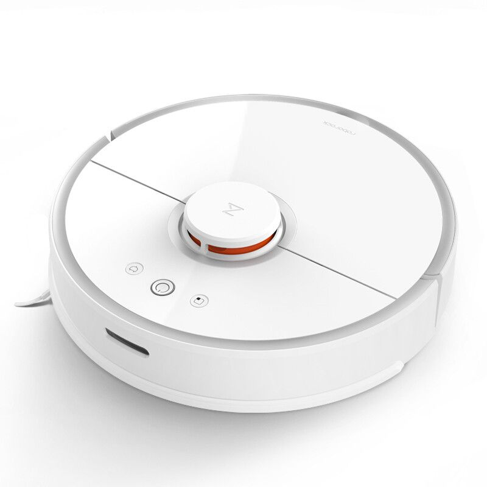
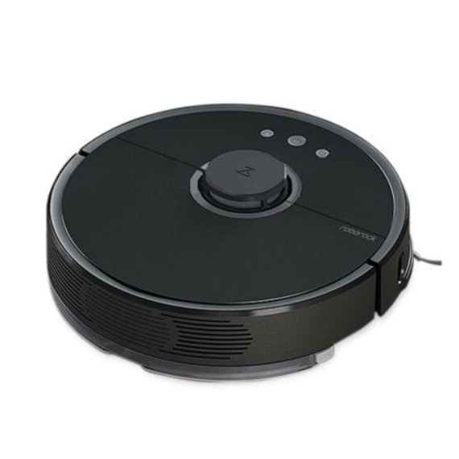
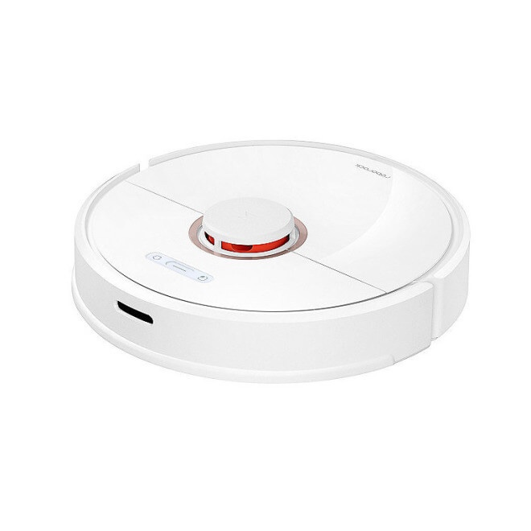
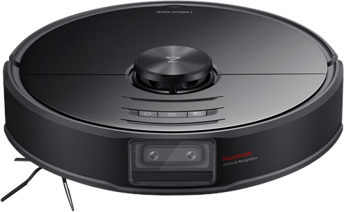

<!-- prettier-ignore -->
> [!NOTE]
> **Beta testers wanted**
>
> The maintainer no longer owns most of the supported vacuums, so changes are developed against automated tests and validated by users.
> If you'd like to help, [sign up as a beta tester](https://github.com/homebridge-xiaomi-roborock-vacuum/homebridge-xiaomi-roborock-vacuum/issues/1232): you'll be mentioned when a beta needs a device like yours.
> See [CONTRIBUTING.md](./CONTRIBUTING.md) for other ways to help. Co-maintainers are welcome too.

<p align="center">
  
  
  
</p>

<h1 align="center">homebridge-xiaomi-roborock-vacuum</h1>

<p align="center">
  <a href="https://github.com/homebridge/homebridge/wiki/Verified-Plugins"></a>
  <a href="https://www.npmjs.com/package/homebridge-xiaomi-roborock-vacuum"></a>
  <a href="https://www.npmjs.com/package/homebridge-xiaomi-roborock-vacuum"></a>
  <a href="https://github.com/homebridge-xiaomi-roborock-vacuum/homebridge-xiaomi-roborock-vacuum"></a>
  <a href="https://codecov.io/gh/homebridge-xiaomi-roborock-vacuum/homebridge-xiaomi-roborock-vacuum"></a>
</p>

A [Homebridge](https://homebridge.io) plugin to control the Xiaomi / Roborock robot vacuums in the Apple Home app:
as Apple Home's **native robot vacuum** (through Homebridge's Matter support), or as a fan with extra switches and
sensors. It talks to the robot in your local network, with [node-miio](https://github.com/afharo/node-miio).

> [!NOTE]
> Made for the vacuums paired with the  **Mi Home** app. The ones paired with the  **Roborock app** are
> supported too, experimentally: see [Roborock app](docs/roborock-app.md).

<p>







</p>

## Features

- **[Apple Home's robot vacuum](docs/how-it-shows-up.md#robot-vacuum-matter)** (iOS 18.4+): rooms, clean modes, battery,
  dock states and errors.
- Or a **fan** (on/off and the [fan speed](docs/speeds-and-modes.md)) or a **switch**, with a second fan for the
  [water level](docs/speeds-and-modes.md).
- **Room and zone cleaning**, with the rooms read from the robot, or named and drawn on its map in the
  [settings page](docs/settings-page.md).
- **Switches**: pause, find me, go to the dock, go to a spot, dust collection, wash and dry the mop, Do Not Disturb.
- **Sensors**: in the dock, room the robot is in, water tank empty, error, needs maintenance, and the remaining
  life of the brushes, filter and sensors (with a reset after replacing them).
- **No token hunting**: log in to your Xiaomi account with a QR code, and the plugin reads the tokens (and finds the
  robot again if its IP changes). Or, for the vacuums paired with the Roborock app, log in to your
  [Roborock account](docs/roborock-app.md) with a code sent by email.

Most of them are optional: see [Options](docs/options.md). Some depend on the model (e.g. only the Roborock vacuums report
the room they're in).

## Installation

1. Install the plugin from the Homebridge UI (search for "Xiaomi Roborock Vacuum"), or with
   `npm install -g homebridge-xiaomi-roborock-vacuum`. It needs Homebridge 2.3 or later.
2. Open the plugin's settings in the Homebridge UI. The [settings page](docs/settings-page.md) logs in to your account and
   adds your vacuums in one click: the Xiaomi account with a QR code (vacuums paired with the Mi Home app), or the
   Roborock account with a code sent by email (vacuums paired with the Roborock app).
3. Pick [how the vacuum shows up](docs/how-it-shows-up.md), enable the [options](docs/options.md) you want, save, and
   restart Homebridge.

Without the Homebridge UI, add the platform to `config.json` yourself (see [Xiaomi Cloud](docs/xiaomi-cloud.md) to get the
token):

```json
{
  "platforms": [
    {
      "platform": "XiaomiRoborockVacuum",
      "devices": [
        {
          "name": "Vacuum",
          "ip": "192.168.1.150",
          "token": "abcdef1234567890abcdef1234567890",
          "rooms": [
            { "id": 16, "name": "Living room" },
            { "id": 17, "name": "Kitchen" }
          ]
        }
      ]
    }
  ]
}
```

Add one entry to `devices` per vacuum.

> [!NOTE]
> Vacuums configured in the old format (`"accessories": [{ "accessory": "XiaomiRoborockVacuum", … }]`, before 1.0)
> still work, but the Homebridge UI can't edit them, and some features need the platform (`rooms` read from the robot,
> the Matter vacuum, the Xiaomi Cloud). The settings page moves them to the platform in one click.

## Documentation

- [How the vacuum shows up](docs/how-it-shows-up.md): Apple Home's robot vacuum (Matter), a fan or a switch.
- [Options](docs/options.md): every option of a vacuum, by group (connection, switches, sensors, rooms and zones).
- [Fan speeds and water levels](docs/speeds-and-modes.md): what each step of the HomeKit sliders and each Matter clean
  mode sends to the robot, by model.
- [Rooms, zones and spots](docs/rooms-and-zones.md): clean a room or a zone, and send the robot to a spot.
- [Xiaomi Cloud](docs/xiaomi-cloud.md): no token hunting, the robot found again when its IP changes, the current room.
- [Roborock app](docs/roborock-app.md): the vacuums paired with the Roborock app instead of Mi Home.
- [Settings page](docs/settings-page.md): the plugin's tools in the Homebridge UI (logins, vacuums, map).
- [Troubleshooting](docs/troubleshooting.md): is my model supported, it doesn't connect, reporting an issue.

## Trademarks

Xiaomi, Xiaomi Home, Mi Home, Roborock and their logos are trademarks of their respective owners. This README and the
settings page show the apps' icons only to tell which app each section is for. This plugin is an independent project, not affiliated
with, endorsed or sponsored by Xiaomi or Roborock.

The Homebridge logo is used as allowed by the [Homebridge branding guidelines](https://github.com/homebridge/branding):
this is a community plugin, not an official Homebridge project.
