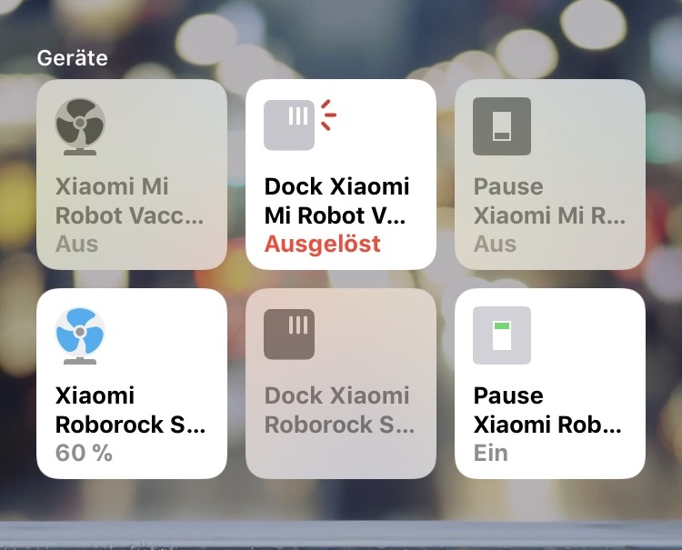
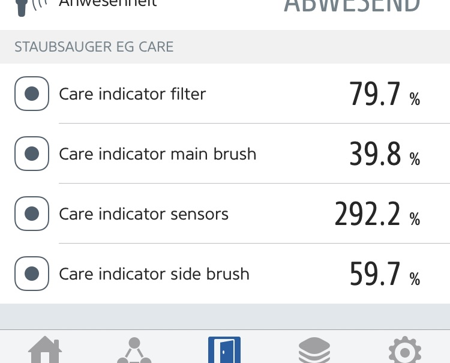

# How the vacuum shows up

[← Back to the README](../README.md)

`serviceType` picks it:

- `"vacuum"`: Apple Home's native [robot vacuum (Matter)](#robot-vacuum-matter). Recommended with iOS 18.4 or later.
- `"fan"` (default): a fan. On starts the cleaning, off sends the robot to the dock, and the speed is the fan speed.
- `"switch"`: a switch, on/off only.




## Robot vacuum (Matter)

Apple Home only shows its robot vacuum tile for Matter devices. With `"serviceType": "vacuum"`, the plugin exposes the
vacuum through Homebridge's Matter support:

- Start, stop, pause, resume and go to the dock.
- The rooms: pick the ones to clean in the Home app. They're read from the robot, or taken from `rooms` / `autoroom`
  when set. With the [Xiaomi Cloud](xiaomi-cloud.md) or the [Roborock app](roborock-app.md), the Home app shows
  the room the robot is in.
- The clean modes: one per fan speed, mop-only (on the models with a "Mop" fan speed), and vacuum & mop presets
  (Automatic, Deep clean, Quiet) on the models with a water box. What each one sets on your model: [Fan speeds and water
  levels](speeds-and-modes.md).
- The battery, the dock states (charging, emptying the dust bin, washing the mop…) and the errors.

To set it up:

1. Enable Matter in the bridge that runs the plugin: a `matter` block in its `_bridge` (a child bridge, recommended)
   or in `bridge`. In the Homebridge UI, it's in the bridge settings.

   ```json
   {
     "platform": "XiaomiRoborockVacuum",
     "devices": [
       {
         "name": "Vacuum",
         "ip": "192.168.1.150",
         "token": "…",
         "serviceType": "vacuum"
       }
     ],
     "_bridge": { "username": "0E:12:34:56:78:9A", "port": 51830, "matter": {} }
   }
   ```

2. Restart Homebridge, and add the vacuum in the Home app with **its own pairing code**, shown in the Homebridge UI and
   in the logs (`Commissioning codes for …`). Apple Home pairs robot vacuums separately from the bridge.
   It gets the vacuum's `name`. Vacuums paired before 1.5.0 were named after their model (e.g. `roborock.vacuum.a15`):
   rename them in the Home app.

The Matter vacuum replaces the fan and these options: `pause`, `findMe`, `goToDock`, `dock`, `waterBox`,
`roomSensors` and the room switches. The options Matter doesn't cover stay in HomeKit, as a separate accessory, when
enabled: zones, go to, spots, dust bin and collection, mop wash and drying, water tank, Do Not Disturb, the error and
maintenance sensors, and the care services (only with `"disableCareServices": false`).

Without Matter, the plugin logs a warning and shows a fan. Switching back to `"fan"` or `"switch"` removes the Matter
vacuum: remove it from the Home app too.
