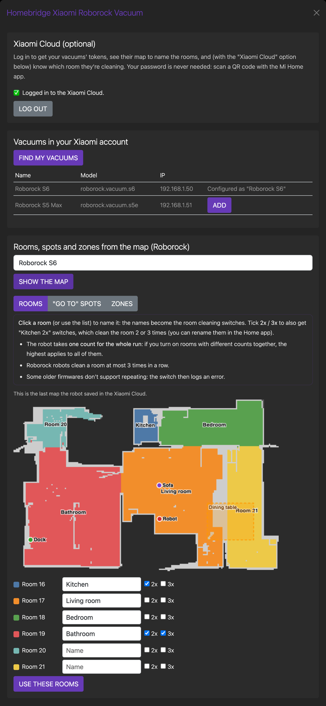

# Settings page

[← Back to the README](../README.md)

The plugin's settings in the Homebridge UI show these tools above the usual form, which they fill in:

- **Xiaomi Cloud login**, with a QR code.
- **Your vacuums** in the Xiaomi account: add them (with their `did`, IP and token) or update their token, in one
  click.
- **Roborock app account login**, with a code sent by email, and **your vacuums** in that account: add them (with
  their `duid`) in one click.
- **Vacuums in the old format** (`accessories`), if any: moved to the platform in one click, with their options and
  child bridge, after a backup of the config. The Home app sees them as new accessories: put them back in their rooms,
  and update your scenes and automations.
- **The map** of a Roborock vacuum: click the rooms to name them (`rooms`, with **2x** / **3x** for the repeats), click
  to add "go to" spots (`goToSpots`), and drag to draw zones (`zones`). Spots and zones belong to the current map:
  pick them again if it's reset.

Click "Save" to apply the changes.

